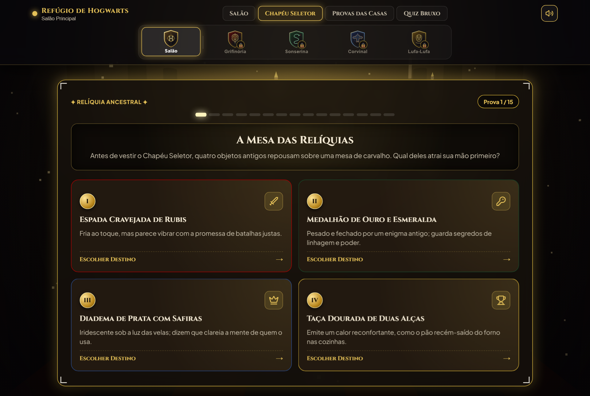
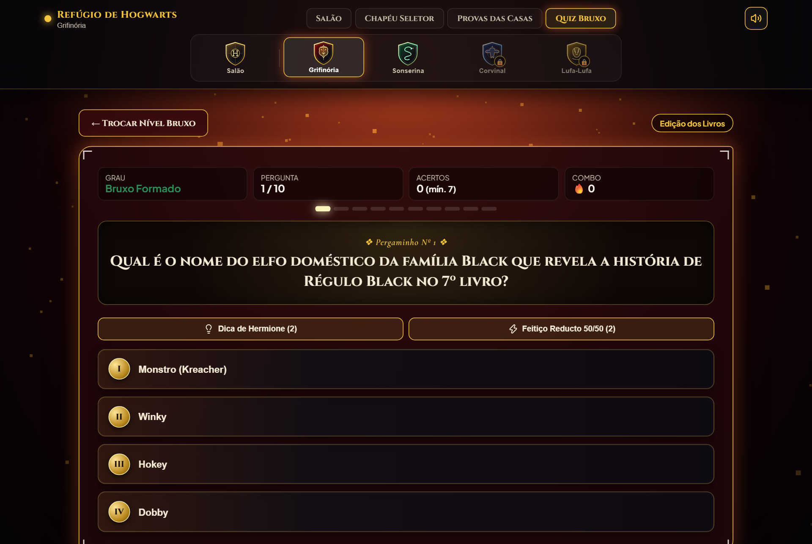
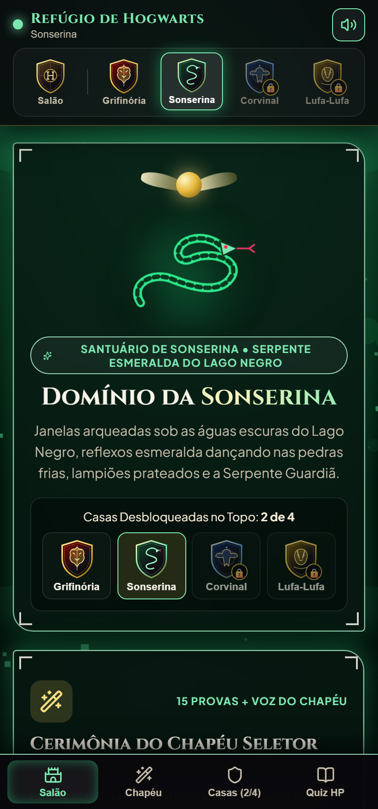

# 🏰 Refúgio de Hogwarts — Chapéu Seletor 3D & Quiz Harry Potter

> Um santuário interativo **Mobile-First** no universo de **Harry Potter** (Livros 1–7 & Filmes 1–8), construído com **React 18**, **Three.js (WebGL 3D)**, **Web Audio API** e **Web Speech API (Voz do Chapéu Seletor)**.

🌐 **Jogue agora em Produção (Vercel):** [https://quiz.gabrieldagostim.com](https://quiz.gabrieldagostim.com)

---

## 📸 Screenshots (Prints do Sistema)

### 1. Modo Neutro Padrão — O Salão Principal de Banquetes (3D)
Ao entrar no site pela primeira vez, o jogador é recebido no **Salão Principal de Banquetes** (com as 4 longas mesas em perspectiva 3D, cálices dourados e 36 velas flutuantes sob o teto encantado). Os brasões das 4 Casas no topo começam selados (`🔒`).


---

### 2. Cerimônia do Chapéu Seletor (15 Provas Ramificadas + Voz)
Fluxo adaptativo de **15 provações multimodais** (Relíquias, Poções, Feitiços, Balança de Valores e Espelho de Ojesed). Nenhuma pergunta elimina uma Casa precocemente: o algoritmo calcula pesos entre as 4 Casas e 8 Virtudes dos Fundadores. Ao final, o **Chapéu Seletor anuncia em voz alta** a Casa escolhida e aplica automaticamente seu Tema 3D ao site!



---

### 3. Provas das Casas & Desbloqueio dos Guardiões 3D (Tema Grifinória Ativo)
Depois de passar pelo Chapéu Seletor, o jogador pode desbloquear os temas 3D das outras 3 Casas vencendo o **Desafio do Guardião** de cada Casa (mínimo de **6/8 acertos**). Se decidir refazer o teste do Chapéu Seletor, o progresso de casas liberadas é zerado e retorna ao Salão Principal.


---

### 4. Desafio dos Saberes Bruxos — Filmes vs. Livros (Grimório & Tábuas de Feitiço)
80 perguntas exclusivas de Harry Potter divididas entre **Edição dos Filmes (8 filmes)** e **Edição dos Livros (7 livros)**, em 4 graus bruxos (**Trouxa**, **Aborto**, **Bruxo Formado** e **Mestre das Relíquias**). Inclui **Dica de Hermione**, **Feitiço Reducto 50/50** e uma **Pegadinha Mágica** caso o jogador escolha um nível acima de sua capacidade e não atinja a nota mínima!



---

### 5. Experiência Mobile-First (Tema 3D da Sonserina & Dock Mágico)
Interface projetada com foco **Mobile-First**, barra superior de troca rápida entre os 5 brasões e dock inferior fixo para navegação com o polegar.

<p align="center">
  
</p>

---

## ✨ Principais Funcionalidades

- **5 Mundos 3D em Three.js (`MagicCanvas.jsx`)**:
  - 🕯️ **Salão Principal (Neutro)**: 4 mesas de banquete em 3D, cálices dourados, pilares góticos e velas flutuantes.
  - 🦁 **Grifinória**: Espadas 3D de Godric Gryffindor com rubis, halo solar dourado e Leão Guardião animado.
  - 🐍 **Sonserina**: Masmorras submersas do Lago Negro com uma Serpente 3D articulada de 28 segmentos deslizando entre colunas.
  - 🦅 **Corvinal**: Observatório Celestial com Esfera Armilar / Astrolábio 3D giratório e Águia de Bronze.
  - 🦡 **Lufa-Lufa**: Santuário Botânico Subterrâneo com anéis hexagonais dourados, cristais de âmbar e Texugo Guardião.
- **Progressão e Desbloqueio no Header**:
  - Os 5 brasões no topo permitem alternar instantaneamente o mundo 3D, a geometria dos grimórios, o Animal Guardião e a trilha sonora.
  - O Chapéu Seletor libera e aplica a primeira Casa; as demais são conquistadas na aba **Provas das Casas**. Refazer o Chapéu reseta as conquistas.
- **Áudio Mágico & Voz do Chapéu (`sound.js`)**:
  - Efeitos sonoros procedurais via **Web Audio API** (acordes por Casa, feitiços, acertos, erros e pegadinha) + síntese de voz em português via **Web Speech API** para o Chapéu Seletor.

---

## 🛠️ Tecnologias Utilizadas

- **React 18** + **Vite**
- **Three.js** (Cenas 3D WebGL responsivas ao toque e mouse)
- **Lucide React** + **SVGs Heráldicos Customizados**
- **Web Audio API** & **Web Speech API**

---

## 🚀 Como Executar Localmente

```bash
# 1. Clone o repositório
git clone https://github.com/gabriel-Dagostim/Quiz-HarryPotter-React.git

# 2. Acesse a pasta do projeto
cd Quiz-HarryPotter-React

# 3. Instale as dependências
npm install

# 4. Inicie o servidor de desenvolvimento
npm run dev
```

Acesse `http://localhost:3000` no navegador.
